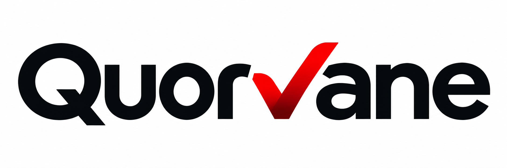

# Quorvane · WolfAlibi

**Trust must be proven.**

**What is Quorvane?** It is security research focused on a straightforward question: **When an AI agent is allowed to act, can we verify who authorized it, what happened, and what the evidence actually proves?**

Quorvane is the public-facing research identity for **WolfAlibi** and its offline security challenge labs. It explores verifiable authorization, constrained agent activity, tamper-evident records, and independent review.

## What it does

- **Checks authorization.** Research prototypes validate narrowly scoped, time-limited owner grants before protected, broker-mediated actions.
- **Measures execution context.** Records process and supervisor context relevant to interpreting an agent's evidence.
- **Preserves verifiable records.** Uses cryptographic receipts, checkpoints, and offline verifiers so claims can be independently inspected.
- **Challenges failures.** Tests forged evidence, replayed requests, revoked or expired permissions, duplicate payment intents, crashes, and lost responses.
- **Separates claims from proof.** A signed historical receipt does **not** establish current permission, complete confinement, or a settled payment.
- **Publishes reproducible tests.** Reviewers can inspect synthetic cases locally, without accessing real customers, schools, banks, or production systems.

## Explore the research

### [Financial Security Challenge · Public Lab 002](https://github.com/Bropdrop/WolfAlibi/blob/5b0319e141dfc83b32a232399578096165b302af/public_lab/financial/README.md)
Offline, synthetic payment-intent and audit challenges: authorization, duplicate effects, historical records, and failure recovery.

[Read the experiment](https://github.com/Bropdrop/WolfAlibi/blob/5b0319e141dfc83b32a232399578096165b302af/public_lab/financial/README.md) · [Download the review ZIP](https://github.com/Bropdrop/WolfAlibi/raw/5b0319e141dfc83b32a232399578096165b302af/public_lab/quorvane-public-lab-002.zip) · [Draft PR #36 and evidence](https://github.com/Bropdrop/WolfAlibi/pull/36)

### [Evidence Explorer · Public Lab 001](https://github.com/Bropdrop/WolfAlibi/blob/1d6dddd654489ebdc3ddc028dc23b59d8d407281/public_lab/README.md)
Explore synthetic signed records, intentionally altered counterparts, and reproducible local verification.

[Read the lab guide](https://github.com/Bropdrop/WolfAlibi/blob/1d6dddd654489ebdc3ddc028dc23b59d8d407281/public_lab/README.md) · [Draft PR #35](https://github.com/Bropdrop/WolfAlibi/pull/35)

## Current status and limits

**Public research prototype — not a finished security product or certification.** The challenge profile is `SIMULATED_POLICY_ONLY`. Production deployment and demonstrated complete agent confinement remain **BLOCKED**; formal certification has **NOT** been issued. Cross-UID custody and coordinated local rollback are not fully qualified.

The implementation and public labs remain in separate **draft research branches/PRs**. This default-branch homepage is a public orientation page; publishing it does **not** merge or release that research code. No open-source license has yet been selected.

**Built in Cape Breton, Nova Scotia, Canada.** 🐺
