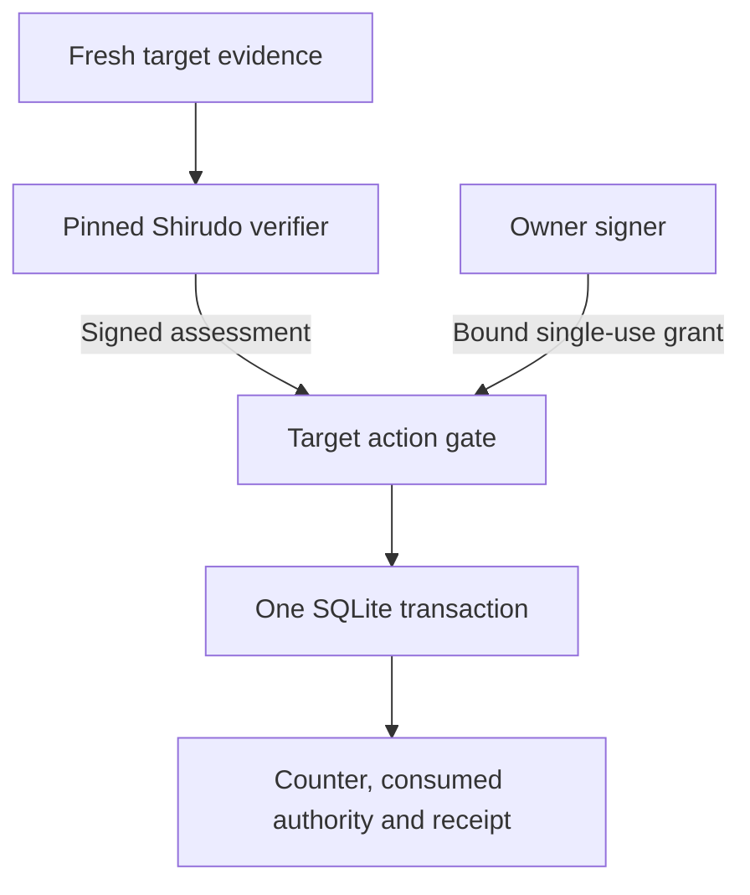

# Shirudo action gate: laboratory contract

This stage adds one target-enforced action to the qualified evidence adapter:
increment a protected SQLite counter by exactly one.

**Qualified within the laboratory scope.**
[CI run 45298950620](https://github.com/Bropdrop/WolfAlibi/actions/runs/45298950620)
passed all 171 host tests, repeated the eight historical verifier checks and
ten fresh-evidence controls, then passed all 26 action checks in the disposable
VM. Twelve fresh assessments were accepted. Exactly four effects committed,
forming the counter history `0 → 1 → 2 → 3 → 4`.

The [qualification record](evidence/ci-45298950620/qualification.json) links the
executed commit, workflow, original archives, independent review and precise
limits. The executed code is
[`521a3c887e86a9d4db0c4b416433146d7161fef9`](https://github.com/Bropdrop/WolfAlibi/commit/521a3c887e86a9d4db0c4b416433146d7161fef9).
The later evidence publication does not change that runtime source.

The target requires both a genuine accepted assessment and an owner-signed
grant for its own operation challenge. Existing Shirudo assessment receipts
continue to carry `authorization: NONE`. They do not become grants.

## Scope and trust

This is `LAB_VTPM` with an ephemeral `LAB_OWNER_GRANT` signer. The builder,
hypervisor, operator, verifier signer, target administrator, local clock,
Python runtime and private target database are trusted. The lab owner key is
an experimental authority, not an assertion that a human approval ceremony
has been implemented.
The two keys are distinct but used by the same trusted host harness. This
experiment does not establish independent custody of those authorities.

The gate and its Python dependencies are installed after boot. Their source
hashes are checked by the trusted installer and retained in the public evidence,
but the Shirudo boot quote does not measure this added software. Grants are
bearer capabilities for one named operation. Socket group membership restricts
who can submit them; the signature does not identify a particular agent process.

The gate runs in the disposable guest. Its state is private to its service
UID; an unprivileged client uses a Unix socket and must not be able to modify
the counter database directly. The only effect is a database increment. No
arbitrary command, pathname, network target or shield operation is accepted.

Attestation freshness is bounded to 30 seconds with at most 2 seconds of
declared cross-host clock skew. The gate admits an adapter challenge at most
5 seconds after issuance, before collecting the laboratory evidence. One
adapter challenge can belong to at most one operation. This does not prove
continuous target state, atomicity between a TPM quote and a later effect,
or resistance to coordinated restoration of all trusted state and clocks.

## Authorization path

The verifier issues a nonce before collection. The target first admits that
signed challenge and returns its own operation challenge. After the verifier
accepts the collected evidence, the owner signer binds one grant to both
records. The client then submits the grant and assessment to the target.



The database transaction is the protected effect boundary. A caller receiving
no reply must query the retained operation ID. It cannot infer that execution
failed or start another operation merely because the connection was lost.

## Core API

`shirudo_adapter.action_gate` provides:

- `Gate.initialize(state_dir, trust)` and `Gate(state_dir)`.
- `Gate.public_identity()` with the target signing public key and instance ID.
- `Gate.prepare(attestation_challenge)` returning a signed action challenge.
- `Gate.execute(request)` returning `COMMITTED` or `ALREADY_COMMITTED` and the
  same signed effect receipt; denial raises `AdapterError`.
- `Gate.status(operation_id=None)` for counter and operation recovery.
- Administrator-only local methods `revoke_grant(grant_id)` and
  `revoke_policy()`; neither is a socket request operation.
- `make_grant_payload(action_challenge, assessment, grant_id=...,
  issued_at_ms=..., expires_at_ms=...)`, returning a strict unsigned payload
  for the separately held owner key.
- `verify_effect_receipt(...)`, using an independently supplied target public
  key and expected operation/grant/assessment bindings.

The existing `sign_record` / `verify_record` Ed25519 envelope is reused.

### Trusted configuration

Exact keys: `schema`, `target_id`, `owner_public_key`,
`verifier_public_key`, `verifier_instance_id`, `policy`.
Schema: `wolfalibi.shirudo.action-trust.v1`. The complete existing policy must
validate and have assurance `LAB_VTPM`. Public keys are 64 lowercase hex
characters; instance and operation IDs are 32; digests and nonces are 64.

### Signed target action challenge

Exact payload keys: `schema`, `gate_instance_id`, `operation_id`,
`operation_nonce`, `target_id`, `policy_sha256`, `policy_generation`,
`attestation_challenge_sha256`, `attestation_challenge_id`,
`attestation_nonce`, `action`, `issued_at_ms`, `expires_at_ms`.
Schema: `wolfalibi.shirudo.action-challenge.v1`.
The sole action is `{"name":"increment_counter","delta":1}`.

### Signed owner grant

Exact payload keys: `schema`, `scope`, `grant_id`, `gate_instance_id`,
`target_id`, `operation_id`, `operation_nonce`, `policy_sha256`,
`policy_generation`, `action`, `action_challenge_sha256`,
`attestation_challenge_sha256`, `attestation_receipt_sha256`,
`issued_at_ms`, `expires_at_ms`.
Schema: `wolfalibi.shirudo.action-grant.v1`; scope: `LAB_OWNER_GRANT`.
The grant is signed after assessment, expires no later than the target
operation, and cannot extend the admitted attestation's freshness window.

### Execution request

Exact keys: `operation_id`, `grant`, `assessment`.
`assessment` is the unchanged signed Shirudo receipt. The target checks the
trusted verifier key and instance, target and policy, exact admitted
challenge fields, enrolled-record digest, approved executable/version pins,
`EVIDENCE_ACCEPTED`, `LAB_VTPM`, `UPSTREAM_CLI`, and the complete recorded
upstream report contract. The owner grant must match all retained bindings.

### Signed effect receipt

Payload fields: `schema`, `scope`, `authorization`, `receipt_id`,
`gate_instance_id`, `target_id`, `operation_id`, `operation_nonce`,
`policy_sha256`, `policy_generation`, `grant_id`, `grant_sha256`,
`attestation_receipt_sha256`, `attestation_challenge_sha256`, `action`,
`counter_before`, `counter_after`, `committed_at_ms`.
Schema: `wolfalibi.shirudo.effect-receipt.v1`; scope:
`LAB_COUNTER_EFFECT_ONLY`; authorization: `CONSUMED_FOR_RECORDED_EFFECT`.
It authenticates a past effect; verification returns no current authority.

## Atomicity and recovery

The target uses `BEGIN IMMEDIATE`, durable SQLite settings and one database
transaction for policy/grant revocation checks, operation consumption, the
counter increment and the signed effect receipt. Validity is checked again
immediately before commit. A committed grant and assessment challenge cannot
authorize another operation.

An exact retry of a completed request returns its stored receipt and makes
no new effect, even after expiry or revocation. A different request for that
operation is rejected. A caller that loses the response sees an ambiguous
transport outcome and recovers by querying the operation. The laboratory
tests process termination before commit and after commit before reply;
these are process-interruption tests, not power-loss qualification.

## Transport contract

`python -m shirudo_adapter.action_gate_cli` provides `init`, `serve`,
`request`, `status`, `revoke-grant`, and `revoke-policy` subcommands.
The socket accepts only `prepare`, `execute`, and `status`, each with exact
request keys. Requests and responses use bounded length-prefixed JSON.
Malformed or unavailable transports do not produce a successful effect
claim. An administrator may request a one-shot process-exit fault for the
laboratory; the client protocol exposes no fault or administration operation.

The CI harness transfers only a bounded public source/configuration archive
over the existing trusted guest connection. It verifies the archive, records
hashes of the source bytes written by the trusted installer, and compares those
records with the approved source before use. The owner key stays in host memory; the verifier key
and journal stay in a separate host temporary directory. The target signer and
database remain private in the guest. Public exports include request, grant,
assessment, decision, receipt, ledger observations, trust metadata, source
digests and test outcomes. The database oracle runs separate read-only SQL.
After a pre-commit process exit, restarting the trusted gate first permits
SQLite's ordinary crash recovery; no execution request is sent during recovery.

## Required evidence

Qualification must demonstrate a real accepted Shirudo assessment, an
authorized counter effect, denial of missing/forged/widened/mismatched
authority, grant and policy revocation, real expiry, duplicate and concurrent
requests, recovery after lost reply, rollback before commit, and denial of
direct database access from the unprivileged client UID. Each case records
the observed counter delta. No simulated fixture can qualify the genuine
integration path.

The action harness requires all 26 named cases, twelve newly collected and
accepted assessments, and exactly four committed counter effects. Every
denial checks a specific reason. Each successful effect receipt is checked
against the independently pinned target key, retained signed inputs and a
separate SQLite observation. A failed connection produces `AMBIGUOUS`; it
cannot substitute for a policy denial or establish that no effect occurred.

## Running the qualification

The `Shirudo action gate integration` workflow on
`feat/shirudo-action-gate-v1` first runs the complete local test suite on a
host that permits Unix sockets. It then repeats genuine historical Gate A,
boots the approved disposable upstream VM, repeats fresh-evidence Gate B and
runs this action experiment. Its final cleanup stops the named VM even when
an assertion fails. Public artifact upload selects only the explicit evidence
directory; target and verifier private state are excluded.

The action harness is restricted to that disposable CI environment. Its
arguments identify the already booted named VM and pinned verifier:

```bash
python scripts/shirudo_action_lab.py \
  --upstream ./upstream \
  --vm-name "$VM_NAME" \
  --verifier ./artifacts/verifier/shirudo \
  --output ./evidence/action
```

The workflow's dependency helper prepares the guest interpreter first. The
gate CLI is also available as `wolfalibi-shirudo-action-gate` or
`python -m shirudo_adapter.action_gate_cli`. `--help` describes the explicit
state and socket paths. A new deployment requires a separately approved trust
file; no key or target is inferred from a submitted receipt.

## Review the preserved evidence

The original [public lab archive](evidence/ci-45298950620/lab-public-records.zip)
contains both the repeated Gate B and new action records. Its SHA-256 is
`29393789222e073b325e72645f83c50288082037259a238fe39c1b8e67522c11`.
The separate [historical archive](evidence/ci-45298950620/offline-public-records.zip)
has SHA-256
`e50fdf6e068966ee4eaa2f09481652a205a0d55878c2bde7f4af5c727f371e8d`.
Both matched the authenticated GitHub artifact metadata when downloaded;
[the provenance record](evidence/ci-45298950620/artifact-provenance.json)
retains that association.

From the repository root, extract into a new review directory and run:

```bash
python -m zipfile -e \
  docs/shirudo/evidence/ci-45298950620/lab-public-records.zip \
  ./action-evidence-review

python docs/shirudo/review_action_artifact.py \
  ./action-evidence-review/evidence/action

python docs/shirudo/review_action_corruptions.py \
  ./action-evidence-review/evidence/action
```

The standalone reviewer imports no adapter code and performs no target or
network operation. Its [recorded pass](evidence/ci-45298950620/action-artifact-review.json)
checked 185 files, all twelve material sets, the complete accepted report
contract, all 26 controls and four unique effects. It performed 80 signature
verifications, including repeated bindings. It also compared the trusted
installer's source records and source archive with the executed commit.

The [seven corruption controls](evidence/ci-45298950620/review-corruption-checks.json)
all failed at their expected checks. Their modified file manifests were
recomputed, so the signature, ledger, counter and source controls had to reach
the corresponding semantic checks. The original evidence was unchanged.

These reviews authenticate retained records under the laboratory public keys.
They do not rerun TPM cryptography or replace the separately checked CI
provenance. Root database observations and process-exit observations remain
trusted laboratory measurements. VM shutdown succeeded; its private state was
not uploaded, and secure erasure was not qualified.
